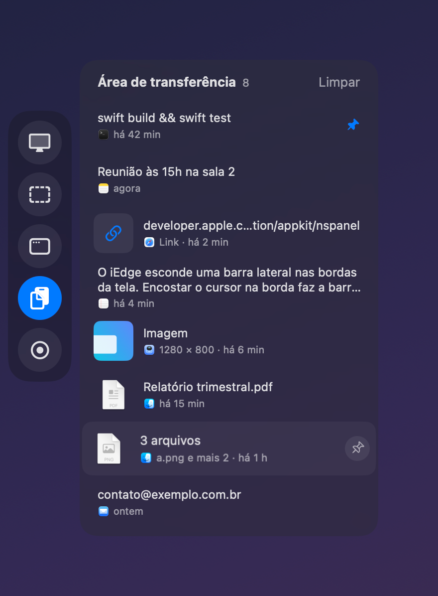
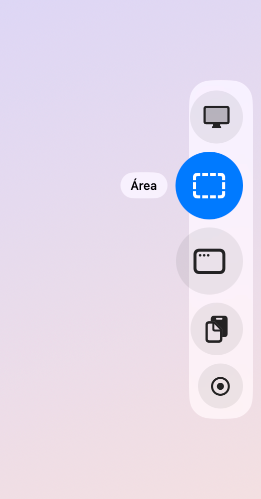
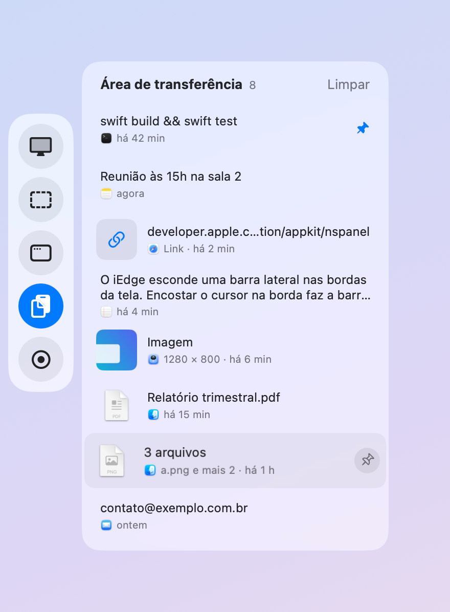
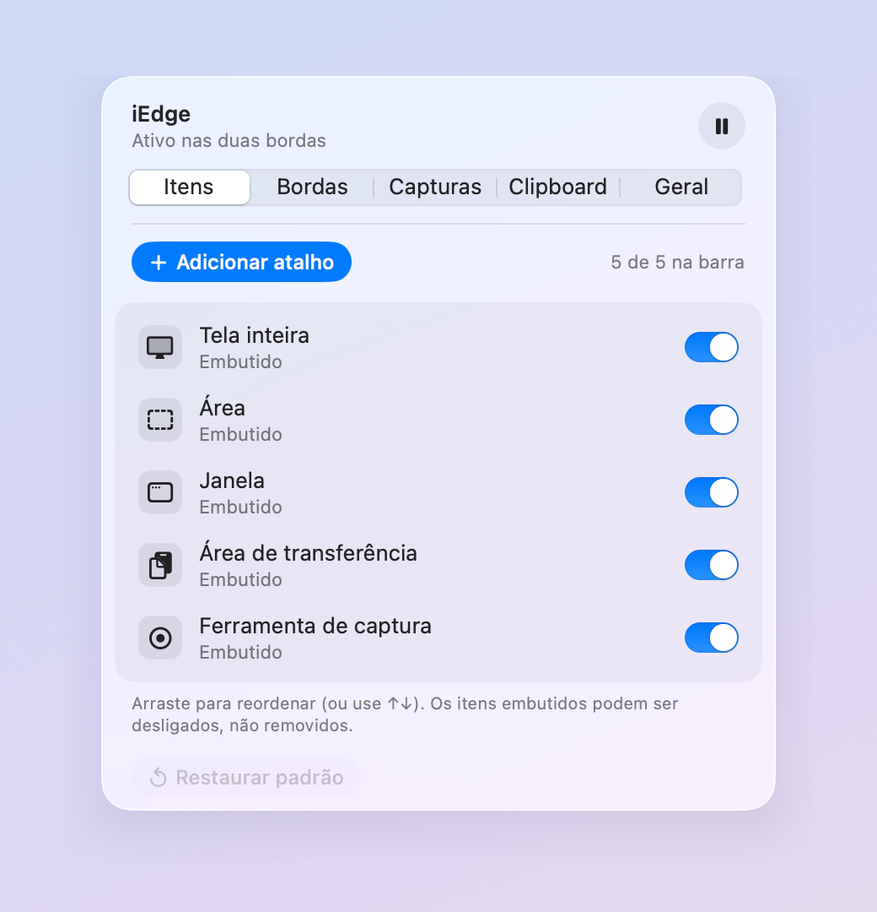
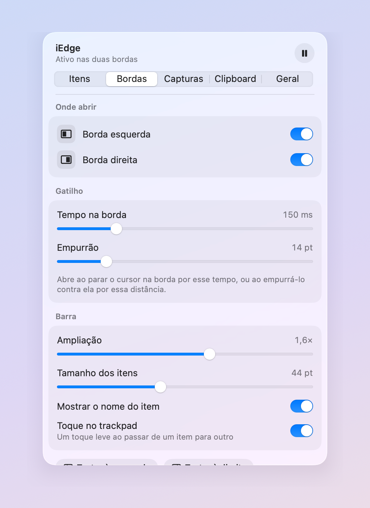

# iEdge

[](https://github.com/dinsightsbr/iEdge/actions/workflows/ci.yml)
[](https://github.com/dinsightsbr/iEdge/releases/latest)
[](LICENSE)


**English** · [Português (Brasil)](README.pt-BR.md)

A sidebar that springs out of the edge of your Mac's screen, with screenshots, clipboard history
and your own shortcuts one flick of the cursor away.

<p align="center">
  
</p>

iEdge is a native menu-bar app (Swift, SwiftUI and AppKit) with no dependencies and no network
access. It uses the visual language of the macOS Control Center: Liquid Glass on macOS 26 and the
system material on macOS 14–15.

> **Language:** the app's interface is in Brazilian Portuguese for now. Localization is very
> welcome. See [Contributing](#contributing).

## What it does

- **A sidebar that springs from the edge.** Rest the cursor on the left or right edge of the
  screen for a moment (150 ms by default), or push against it, and a glass capsule springs out at
  the height of the cursor. It stays out of the way: it never opens in the top and bottom corners,
  while a mouse button is held (dragging a window, selecting text), on the edge where the Dock is,
  on an edge that touches another display, or while iEdge is paused.
- **A magnifier like the Dock's.** Run the cursor along the sidebar and the closest item grows
  into the screen, pushing its neighbours apart, with its name beside it and a light trackpad tap
  when the selection changes.
- **Screenshots.** Full screen (the display the sidebar was on), area and window, through the
  system's `screencapture`. The sidebar closes first, so it never shows up in a capture. A preview
  springs out of the same edge for 3 seconds: click to open it in Preview, drag it to drop the file
  anywhere. There is also a button for the Screenshot app (⌘⇧5, which also records the screen).
- **Clipboard history.** Text, images, files and links, with the app they came from and how long
  ago. Pin the ones you want to keep; click an entry to copy it back and, optionally, paste it
  straight into the frontmost app.
- **Your own shortcuts.** Open an app, open a link or file, run a shortcut from the Shortcuts app,
  or run a shell command. A failure shows a short notice at the edge, never a modal alert.

<p align="center">
  
  &nbsp;&nbsp;
  
</p>

## Install

1. Download `iEdge-<version>.zip` from the [latest release](https://github.com/dinsightsbr/iEdge/releases/latest)
   (each release also lists the zip's SHA-256).
2. Unzip it and move `iEdge.app` to `/Applications`.
3. Open it. The icon (`sidebar.squares.left`) appears in the menu bar; there is no Dock icon.

iEdge is **signed ad hoc and not notarized**, so on first launch macOS says it cannot verify the
developer. Either right-click `iEdge.app` in Finder, choose **Open** and confirm, or clear the
quarantine flag from Terminal:

```bash
xattr -dr com.apple.quarantine /Applications/iEdge.app
```

Requires macOS 14 (Sonoma) or later.

## Build from source

Requirements:

- A Mac with **Xcode 26 or later** (or the matching Command Line Tools). The code uses Liquid Glass
  (`NSGlassEffectView` and SwiftUI's `glassEffect`), which only exists in the **macOS 26 SDK**; it
  is guarded at runtime, so the app still runs on macOS 14 and 15.
- Nothing else: no packages, no network.

```bash
swift build                     # debug build
swift test                      # unit tests
bash scripts/build-app.sh       # release build, wrapped and signed ad hoc in build/iEdge.app
open build/iEdge.app
```

To install your build: `rm -rf /Applications/iEdge.app && cp -R build/iEdge.app /Applications/`.

Permissions and **Open at login** only behave properly from the `.app` bundle. Because the bundle
is signed ad hoc, macOS may treat each new build as a different app: if a permission you granted
"disappears" after rebuilding, remove iEdge from the list in System Settings and grant it again.

## Permissions

iEdge asks only for what each feature needs, and works without them (that feature is simply left
out). Settings shows the state of each one and re-reads it while open, so you can grant it in
System Settings and come back.

| Permission | What it enables |
| --- | --- |
| **Screen Recording** | Full-screen, area and window screenshots. Without it, clicking a capture item shows a notice with a shortcut to the right System Settings pane. |
| **Accessibility** | **Paste automatically** (*Colar automaticamente*): sending ⌘V to the frontmost app after you pick a clipboard entry. Without it, the entry is only copied. |

Detecting the edge needs no permission at all: mouse-move events don't require Accessibility.
**Open at login** (*Abrir ao iniciar sessão*) uses `SMAppService` and works only with
`iEdge.app` in `/Applications`.

## Privacy

- **No network.** iEdge itself makes no network requests: no analytics, no telemetry, no update
  checks. (A link or shell command you add as a shortcut does whatever it does, of course.)
- **Everything stays on your Mac**, in `~/Library/Application Support/iEdge/`:
  - `settings.json`: settings and sidebar items;
  - `clipboard.json`: the clipboard history (only with **Save history**, *Guardar o histórico*, on);
  - `clipboard/`: copied images (`<id>.png` and a `<id>-thumb.png` thumbnail).
- **What the clipboard history never records:**
  - copies marked as concealed, transient or auto-generated (`org.nspasteboard.ConcealedType`,
    `TransientType`, `AutoGeneratedType`), which is how password managers mark passwords;
  - copies made in excluded apps (1Password, Bitwarden, Passwords and Keychain Access by default;
    you can edit the list);
  - text over 200 KB and images over 20 MB;
  - iEdge's own writes to the clipboard.
- With **Save history** off, the history lives only in memory and its images are deleted on quit.
  **Clear history** (*Limpar histórico*) removes every entry except the pinned ones, along with
  their files. If `settings.json` or `clipboard.json` can't be read, iEdge starts from the defaults
  and keeps the original as `settings.json.corrompido` / `clipboard.json.corrompido`.
- Copied content is never written to the system log.
- Screenshots go to the system's screenshot folder (or one you choose), the clipboard, or both.

To remove all of iEdge's data, quit it and delete `~/Library/Application Support/iEdge/`.

## Settings

Click the menu-bar icon to open Settings in a glass panel below it (Esc or a click outside closes
it). Right-click it for the quick menu: Pause/Resume, Show left sidebar, Show right sidebar,
Settings…, Quit. Everything saves immediately.

| Tab | What's in it |
| --- | --- |
| **Itens** (Items) | The sidebar items in order: a switch for each, drag (or ↑↓) to reorder, **Add shortcut** (app, link, Shortcuts shortcut or shell command, with a name and an SF Symbol), edit and remove your own shortcuts, **Restore defaults**. |
| **Bordas** (Edges) | Left and right edge (with a warning when the Dock is on that side), time on the edge, push distance, magnification, item size, item names, trackpad tap, and **Test** buttons for each edge. |
| **Capturas** (Screenshots) | Destination (file, clipboard or both), folder, sound, preview, and the Screen Recording permission. |
| **Clipboard** | Save history, history size (20–200 entries), paste automatically, excluded apps, **Clear history**. |
| **Geral** (General) | Open at login, pause, permissions, version and Quit. |

<p align="center">
  
  &nbsp;
  
</p>

## Development

`bash scripts/run-dev.sh [flags]` runs the debug build straight from SwiftPM and passes any flags
through. These development flags exist to make the app easy to inspect and screenshot:

| Flag | Effect |
| --- | --- |
| `--demo` | settings and clipboard in memory, with 8 sample entries; nothing is read from or written to disk |
| `--show left\|right` | opens the sidebar on that edge of the main screen at launch |
| `--pin` | the sidebar doesn't close by itself |
| `--hover 0.0…1.0` | simulates the cursor at that fraction of the sidebar's height (magnifier) |
| `--flyout` | opens the clipboard history with the sidebar |
| `--settings [itens\|bordas\|capturas\|clipboard\|geral]` | opens Settings on that tab |
| `--backdrop` | a full-screen gradient behind the panels, so screenshots show nothing of your screen |
| `--scheme light\|dark` | appearance for `--snapshot` and `--backdrop` |
| `--frame-file <file>` | writes `x y w h` of each open panel, in `screencapture -R` coordinates |
| `--snapshot <name> --out <file.png>` | renders one view to a PNG and exits, without opening a window |
| `--snapshot list` | lists the available snapshots |

```bash
# Render a view without launching the app
.build/debug/iEdge --snapshot clipboard --out /tmp/clip.png --scheme dark

# Screenshot the real app on a clean background
.build/debug/iEdge --demo --backdrop --show left --pin --flyout --frame-file /tmp/frames.txt &
sleep 4 && cat /tmp/frames.txt   # x y w h per panel, origin at the top left
```

Glass doesn't render outside a window, so `--snapshot` draws a translucent gray instead; native
controls are replaced by drawn stand-ins (see `Sources/iEdge/Core/SnapshotSupport.swift`). Use
`--backdrop` with the real app when you need the real glass. The images in `docs/images/` were
taken this way.

The app icon is drawn in code by `scripts/make-icon.swift`; run `swift scripts/make-icon.swift`
to regenerate `Resources/AppIcon.icns`. Logs use the subsystem `br.dinsights.iedge`:

```bash
log stream --predicate 'subsystem == "br.dinsights.iedge"'
```

## Architecture

```
Sources/iEdge/
  App/        entry point, AppDelegate (wires everything), development flags
  Core/       glass panel, theme, paths, logging, snapshot mode
  Models/     settings, sidebar items, actions, clipboard entries
  Stores/     SettingsStore (settings.json)
  Edge/       EdgeMonitor and the pure edge geometry
  Sidebar/    the sidebar panel, its view, the pure magnifier, the clipboard flyout
  Actions/    screenshots, custom shortcuts, the preview toast
  Clipboard/  pasteboard monitor, pure history rules, store, list view
  MenuBar/    status item and the Settings panel
  Settings/   one view per tab, permissions, login item
```

The edge monitor watches mouse-move events and tells the sidebar controller to show itself; the
sidebar runs a display link only while it is visible, and hands the clicked item to the action
runner after it has closed. The rules that matter (edge geometry, magnifier, clipboard history,
settings decoding, capture arguments) are pure functions with unit tests. See
[docs/ARCHITECTURE.md](docs/ARCHITECTURE.md) for the full picture, and
[docs/SPEC.md](docs/SPEC.md) for the original design spec (in Portuguese).

## Contributing

Contributions are welcome, in English or Portuguese: bug reports, ideas, fixes, and especially
localization of the interface. Please read [CONTRIBUTING.md](CONTRIBUTING.md) and the
[Code of Conduct](CODE_OF_CONDUCT.md). To report a security issue, see [SECURITY.md](SECURITY.md).

## License

[MIT](LICENSE) © 2026 Data Insights
