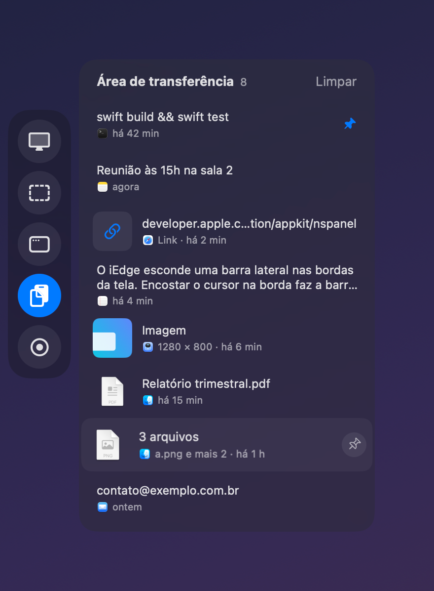
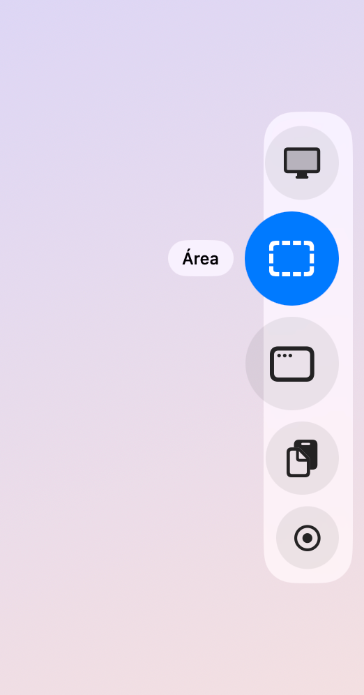
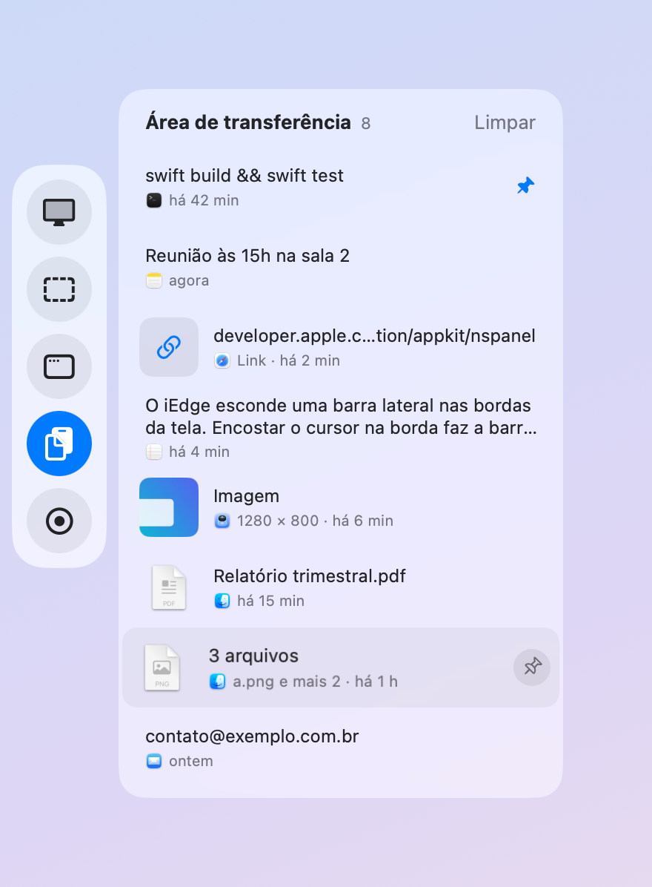
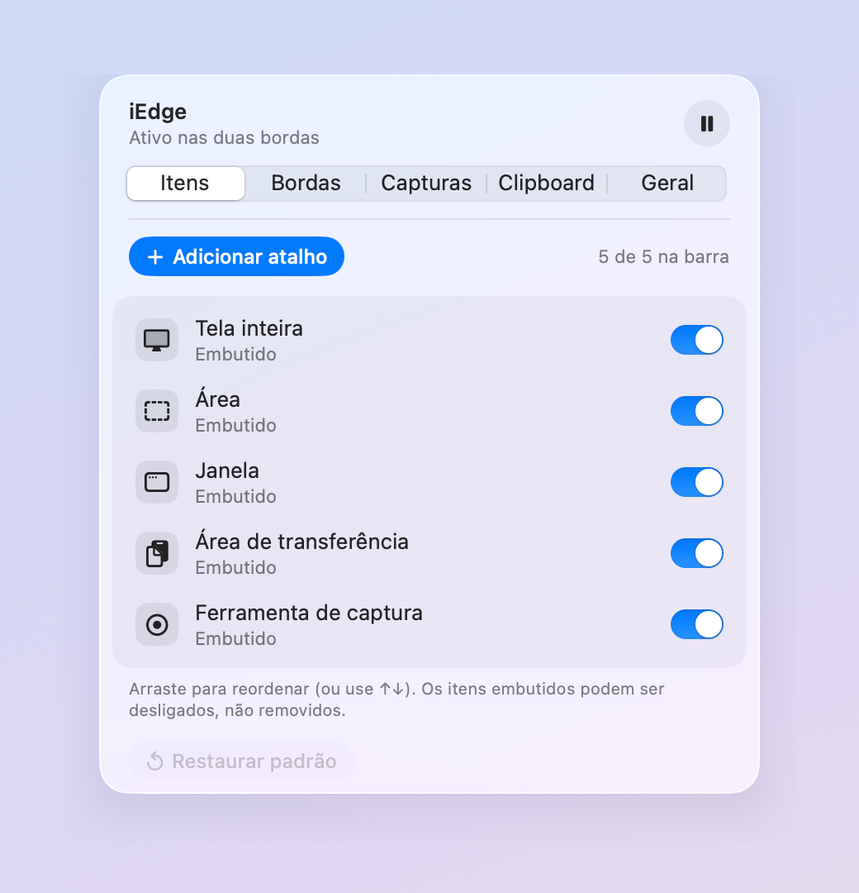
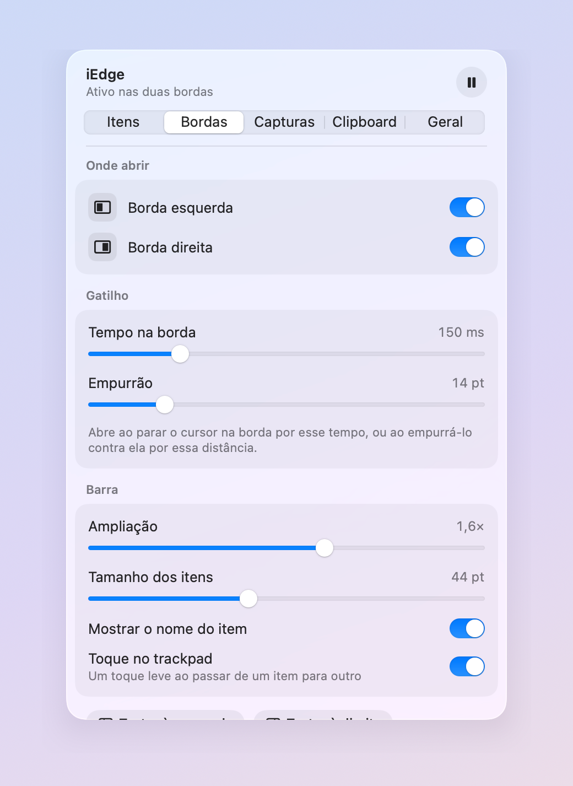

# iEdge

[](https://github.com/dinsightsbr/iEdge/actions/workflows/ci.yml)
[](https://github.com/dinsightsbr/iEdge/releases/latest)
[](LICENSE)


[English](README.md) · **Português (Brasil)**

Uma barra que salta da borda da tela do Mac, com capturas de tela, histórico da área de
transferência e os seus atalhos a um movimento do cursor.

<p align="center">
  
</p>

O iEdge é um app nativo de barra de menus (Swift, SwiftUI e AppKit), sem dependências e sem acesso
à rede. Segue a linguagem visual da Central de Controle do macOS: Liquid Glass no macOS 26 e o
material do sistema no macOS 14–15.

> **Idioma:** a interface do app está em português do Brasil por enquanto. Contribuições de
> localização são muito bem-vindas; veja [Contribuir](#contribuir).

## O que faz

- **Uma barra que salta da borda.** Encoste o cursor na borda esquerda ou direita e deixe parado
  um instante (150 ms por padrão), ou empurre contra ela: a cápsula de vidro salta da borda com
  mola, 8 pt afastada dela, na altura do cursor. Não abre nos cantos (32 pt de cima e de baixo),
  com um botão do mouse apertado (arrastando janela, selecionando texto), na borda onde está o
  Dock, numa borda que encosta em outra tela, nem com o iEdge pausado. Depois de fechar, só reabre
  quando o cursor sair da borda.
- **Lupa como a do Dock.** Com a barra aberta, o item mais perto do cursor cresce para dentro da
  tela e empurra os vizinhos, com o nome dele numa cápsula ao lado e um toque leve no trackpad ao
  trocar de item.
- **Clique** num item executa. A barra fecha antes, então as capturas nunca a pegam. Ela também
  fecha quando o cursor se afasta mais de 40 pt ou com um clique fora.
- **Itens padrão**, nesta ordem: Tela inteira, Área, Janela, Área de transferência e Ferramenta de
  captura (o app Captura de Tela, ⌘⇧5, que também grava a tela).
- **Capturas** usam `/usr/sbin/screencapture`. Tela inteira pega a tela onde a barra estava; Área e
  Janela são interativas (Esc cancela, sem arquivo e sem aviso). O arquivo vai para a pasta de
  capturas do sistema (ou a escolhida) como `Captura de Tela 2026-11-18 às 14.05.33.png`. A prévia
  salta da mesma borda por 3 s (pausa com o cursor em cima): clique abre no Pré-Visualização,
  arrastar leva o arquivo.
- **Área de transferência**: parar 250 ms sobre o item (ou clicar) abre o histórico ao lado da
  barra: texto, imagens, arquivos e links, com o app de origem e há quanto tempo. Fixadas ficam no
  topo e não saem pelo limite. Clicar numa entrada copia de volta e, com **Colar automaticamente**,
  manda ⌘V ao app da frente.
- **Atalhos seus**: abrir app, abrir link ou arquivo, rodar um atalho do app Atalhos
  (`shortcuts run`) ou um comando (`/bin/zsh -lc`, sem terminal, saída descartada). Uma falha vira
  um aviso curto na borda, nunca um alerta.

<p align="center">
  
  &nbsp;&nbsp;
  
</p>

## Instalar

1. Baixe `iEdge-<versão>.zip` da [última release](https://github.com/dinsightsbr/iEdge/releases/latest)
   (cada release traz também o SHA-256 do zip).
2. Descompacte e mova o `iEdge.app` para `/Applications`.
3. Abra. O ícone (`sidebar.squares.left`) aparece na barra de menus; não há ícone no Dock.

O iEdge é **assinado ad-hoc e não notarizado**, então na primeira vez o macOS diz que não pode
verificar o desenvolvedor. Clique com o botão direito no `iEdge.app` no Finder, escolha **Abrir** e
confirme, ou tire a marca de quarentena pelo Terminal:

```bash
xattr -dr com.apple.quarantine /Applications/iEdge.app
```

Pede macOS 14 (Sonoma) ou mais novo.

## Compilar

Requisitos:

- Mac com **Xcode 26 ou mais novo** (ou as Command Line Tools correspondentes). O código usa o
  Liquid Glass (`NSGlassEffectView` e o `glassEffect` do SwiftUI), que só existe no **SDK do
  macOS 26**; o uso é protegido em tempo de execução, então o app roda no macOS 14 e 15.
- Mais nada: sem pacotes, sem rede.

```bash
swift build                     # build de debug
swift test                      # testes (geometria da borda, lupa, clipboard, capturas, ajustes)
bash scripts/build-app.sh       # release, assinatura ad-hoc, com ícone, em build/iEdge.app
open build/iEdge.app
```

Para instalar o seu build: `rm -rf /Applications/iEdge.app && cp -R build/iEdge.app /Applications/`.

Permissões e "Abrir ao iniciar sessão" só se comportam direito a partir do `.app`. Como ele é
assinado ad-hoc, cada novo build pode ser visto pelo macOS como outro app: se uma permissão
concedida "sumir" depois de recompilar, remova o iEdge da lista e conceda de novo.

## Permissões

O iEdge pede só o que cada função precisa, e funciona sem elas (a função correspondente fica de
fora). Os Ajustes mostram o estado de cada uma e releem enquanto estão abertos, então dá para
conceder nos Ajustes do Sistema e voltar.

| Permissão | O que libera | Como conceder |
| --- | --- | --- |
| **Gravação de Tela** | Capturas de tela inteira, área e janela. | Ajustes › Capturas ou Geral › **Conceder**. Na primeira vez o macOS mostra o pedido; depois o botão vira **Abrir Ajustes** e leva a Ajustes do Sistema › Privacidade e Segurança › Gravação de Tela e Áudio do Sistema. Ligue o iEdge e reabra o app se o macOS pedir. Sem ela, clicar numa captura mostra um aviso com o atalho para esse painel. |
| **Acessibilidade** | Colar automaticamente (⌘V no app da frente) ao escolher uma entrada do clipboard. | Ao ligar **Colar automaticamente**, ou em Geral › **Conceder**. Leva a Privacidade e Segurança › Acessibilidade; ligue o iEdge. Sem ela, a entrada só é copiada. |

Detectar a borda não pede permissão nenhuma (eventos de movimento do mouse não precisam de
Acessibilidade). **Abrir ao iniciar sessão** usa `SMAppService` e só funciona com o `iEdge.app` em
/Applications; fora disso os Ajustes dizem o que fazer. Se você desligar o iEdge em Ajustes do Sistema ›
Geral › Itens de Início, os Ajustes mostram isso com um botão para reabrir esse painel.

## Privacidade

- **Sem rede.** O iEdge não faz nenhuma requisição de rede: sem análise de uso, sem telemetria,
  sem checagem de atualização. (Um link ou comando que você cadastre como atalho faz o que ele faz,
  claro.)
- **Tudo fica no seu Mac**, em `~/Library/Application Support/iEdge/` (criada no primeiro ajuste
  ou cópia salvos):
  - `settings.json`: ajustes e itens da barra;
  - `clipboard.json`: histórico do clipboard (só com **Guardar o histórico** ligado);
  - `clipboard/`: as imagens copiadas (`<id>.png` e a miniatura `<id>-thumb.png`).
- **O que o histórico nunca guarda:**
  - cópias marcadas como senha, transitórias ou geradas automaticamente
    (`org.nspasteboard.ConcealedType`, `TransientType`, `AutoGeneratedType`), que é como os
    gerenciadores de senha marcam senhas;
  - cópias feitas nos apps excluídos (1Password, Bitwarden, Senhas e Acesso às Chaves por padrão;
    a lista é editável);
  - texto acima de 200 KB e imagem acima de 20 MB;
  - o que o próprio iEdge escreve na área de transferência.
- Com **Guardar o histórico** desligado o histórico fica só na memória, e as imagens são apagadas
  ao sair. **Limpar histórico** apaga tudo menos as fixadas, com os arquivos delas. Se
  `settings.json` ou `clipboard.json` estiverem ilegíveis, o iEdge começa com os padrões e guarda o
  original como `settings.json.corrompido` / `clipboard.json.corrompido`.
- O conteúdo copiado nunca vai para o log do sistema.
- As capturas vão para a pasta de capturas do sistema (ou a escolhida), para a área de
  transferência, ou para as duas.

Para apagar todos os dados do iEdge, saia do app e apague `~/Library/Application Support/iEdge/`.

## Ajustes

O ícone `sidebar.squares.left` fica na barra de menus (meio apagado quando o iEdge está pausado).
**Clique** abre os Ajustes num painel de vidro logo abaixo dele; Esc ou um clique fora fecha.
**Clique direito** abre o menu rápido: Pausar/Retomar, Mostrar barra esquerda, Mostrar barra
direita, Ajustes…, Sair. A barra aberta pelo menu (ou por **Testar**) fica 4 s mesmo com o cursor
longe e depois volta a seguir o cursor. Tudo salva na hora, sem botão Salvar.

| Aba | O que tem |
| --- | --- |
| **Itens** | Os itens da barra, na ordem: interruptor para cada um, arrastar (ou ↑↓ ao passar o cursor) para reordenar. **Adicionar atalho** abre um formulário: App (escolhido em /Applications, o nome vem do app), Link (endereço, domínio ou caminho `~/…`), Atalho (do app Atalhos, com a lista dos seus) ou Comando (`/bin/zsh -lc`), com nome e símbolo SF com prévia. Os atalhos criados podem ser editados e removidos; os embutidos só desligam. **Restaurar padrão** volta os embutidos à ordem original, ligados, e mantém os seus atalhos no fim, desligados. |
| **Bordas** | Borda esquerda e direita (com aviso quando o Dock está naquele lado e a opção de abrir mesmo assim), tempo na borda (80–400 ms), empurrão (4–60 pt), ampliação (desligada a 2×), tamanho dos itens (36–56 pt), nome do item, toque no trackpad e os botões **Testar à esquerda/direita**. |
| **Capturas** | Destino (Arquivo, Clipboard ou Ambos), pasta (escolher uma ou usar a do sistema), som, prévia e o estado da permissão de Gravação de Tela. |
| **Clipboard** | Guardar o histórico, tamanho (20–200 entradas; ao diminuir, as mais antigas saem quando o valor assenta), colar automaticamente, apps excluídos e **Limpar histórico** (as fixadas ficam). |
| **Geral** | Abrir ao iniciar sessão, pausar, permissões, versão e Sair. |

<p align="center">
  
  &nbsp;
  
</p>

## Desenvolvimento

`bash scripts/run-dev.sh [flags]` roda o build de debug direto do SwiftPM (o ícone aparece na barra
de menus; não há ícone no Dock) e repassa as flags. Estas flags existem para facilitar inspecionar
e capturar o app:

| Flag | Efeito |
| --- | --- |
| `--demo` | ajustes e clipboard em memória, com 8 entradas de exemplo; nada lido nem gravado em disco |
| `--show left\|right` | abre a barra nessa borda da tela principal ao iniciar |
| `--pin` | a barra não fecha sozinha |
| `--hover 0.0…1.0` | simula o cursor nessa fração da altura da barra (lupa) |
| `--flyout` | abre o painel do clipboard junto com a barra |
| `--settings [itens\|bordas\|capturas\|clipboard\|geral]` | abre os Ajustes nessa aba |
| `--backdrop` | um gradiente do tamanho da tela atrás dos painéis, para as capturas não mostrarem nada da sua tela |
| `--scheme light\|dark` | aparência do `--snapshot` e do `--backdrop` |
| `--frame-file <arquivo>` | grava `x y w h` de cada painel aberto (coordenadas do `screencapture -R`) |
| `--snapshot <nome> --out <arquivo.png>` | renderiza uma view em PNG e sai, sem abrir janela |
| `--snapshot list` | lista os snapshots disponíveis |

```bash
# Renderizar uma view sem abrir o app
.build/debug/iEdge --snapshot clipboard --out /tmp/clip.png --scheme dark

# Capturar o app real num fundo limpo
.build/debug/iEdge --demo --backdrop --show left --pin --flyout --frame-file /tmp/frames.txt &
sleep 4 && cat /tmp/frames.txt   # x y w h por painel, origem no topo à esquerda
```

Sem `--pin`, a barra de `--show` fecha sozinha 0,25 s depois se o cursor estiver longe dela.

O vidro não renderiza fora de uma janela; no snapshot ele vira um fundo cinza translúcido. Os
controles nativos (segmented, toggle, slider, botões, ScrollView) também não, e por isso as views usam
`.snapshotStandIn { … }` e `LiveScrollView` (veja `Sources/iEdge/Core/SnapshotSupport.swift`). Para
ver o vidro de verdade, use o app real com `--backdrop`; as imagens de `docs/images/` saíram assim.

O ícone sai de `scripts/make-icon.swift` (desenhado em CoreGraphics); para redesenhar:
`swift scripts/make-icon.swift` (grava `Resources/AppIcon.icns`). O log usa o subsystem
`br.dinsights.iedge`:

```bash
log stream --predicate 'subsystem == "br.dinsights.iedge"'
```

## Arquitetura

```
Sources/iEdge/
  App/        main.swift, AppDelegate (liga tudo), LaunchOptions (flags de dev), BackdropWindow
  Core/       Theme, GlassPanel (vidro), AppPaths, Log, Snapshot
  Models/     ScreenEdge, ActionKind, SidebarItem, AppSettings, ClipboardEntry
  Stores/     SettingsStore (settings.json)
  Edge/       EdgeMonitor, EdgeGeometry (funções puras)
  Sidebar/    SidebarController, SidebarPanel, SidebarView, Magnification (pura), ClipboardFlyout
  Actions/    ActionRunner, ScreenshotService, CaptureToast, CustomActions, ActionProcess
  Clipboard/  ClipboardMonitor, ClipboardHistory (pura), ClipboardStore, ClipboardListView
  MenuBar/    StatusItemController
  Settings/   SettingsRootView e uma view por aba, PermissionCenter, LoginItem
Resources/    Info.plist, AppIcon.icns
scripts/      run-dev.sh, build-app.sh, make-icon.swift
Tests/iEdgeTests/
```

O mapa completo, em inglês, está em [docs/ARCHITECTURE.md](docs/ARCHITECTURE.md); a especificação
original (o documento de design) está em [docs/SPEC.md](docs/SPEC.md).

## Contribuir

Contribuições são bem-vindas, em português ou inglês: relatos de bug, ideias, correções e
principalmente a localização da interface. Leia o [CONTRIBUTING.md](CONTRIBUTING.md) e o
[Código de Conduta](CODE_OF_CONDUCT.md). Para relatar um problema de segurança, veja o
[SECURITY.md](SECURITY.md).

## Licença

[MIT](LICENSE) © 2026 Data Insights
